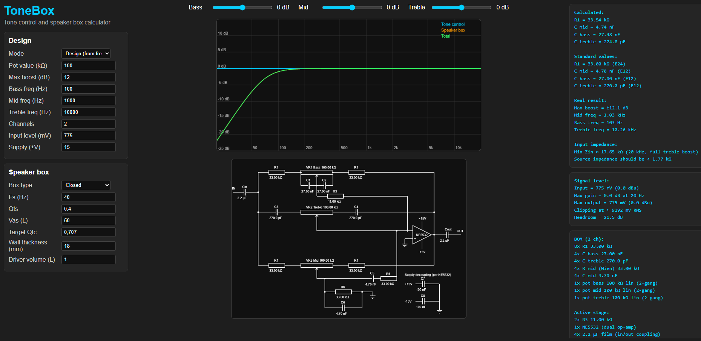

# ToneBox

ToneBox is a web calculator for designing a 3-band Baxandall tone control (bass, mid, treble) and a speaker enclosure. It shows the frequency response of the tone control, the box and both combined, draws the schematic and creates a parts list.

It is part of my DIY audio tool set together with **CrossCalc** (crossover calculator) and **CoilCalc** (coil and transformer calculator).

## Usage

## Features
### Tone control (Baxandall, 3-band)
- **Bass, Mid and treble sliders** with a live frequency response graph
- **Design mode** - enter the pot value, max boost and frequencies, and ToneBox calculates all components
- **Analyze mode** – enter the components you already have and see how the tone control will sound
- **Standard values** – components are rounded to E12 / E24 series, and the real frequencies and boost are recalculated
- **Input impedance** – minimum Zin and the recommended source impedance, with a warning when a buffer is needed
- **Signal level** – output level in mV and dBu, headroom to clipping based on the supply voltage, with a warning when the output will clip
- **Schematic** – the full circuit is drawn with the calculated values, including the NE5532, supply decoupling and in/out coupling capacitors
- **BOM** – parts list for any number of channels
## How to run

### Hosted instance
- [Link!](https://kylda-007.github.io/ToneBox)

### Local hosting
Clone the repository. Open `index.html` in your browser or set up a static web server.